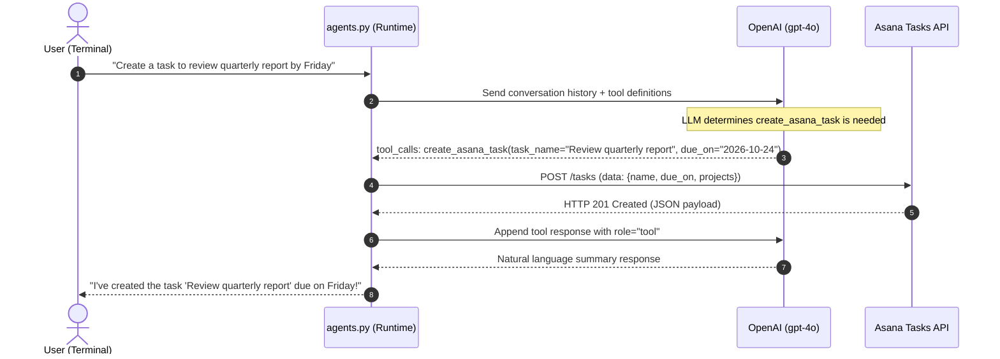

# 01 - First AI Agent: OpenAI Function Calling & Asana Integration

A foundational implementation of an autonomous **Action-Taking AI Agent** built using OpenAI's Function Calling API and Asana's REST API.

---

## 💡 Overview

Standard LLM chatbots are limited to text generation. This module turns a language model into an **active agent** capable of taking real-world actions:
- Understands natural language requests (e.g. *"Remind me to submit the Q3 budget report tomorrow"*).
- Determines if and when external tools need to be executed.
- Extracts structured parameters (`task_name`, `due_on`) conforming to a JSON Schema.
- Automatically connects to Asana and creates real project tasks.
- Synthesizes API responses into friendly, conversational confirmation messages.

---

## 🏗️ Architecture & Interaction Flow



---

## 📁 File Structure

```text
1-first-agent/
├── agents.py           # Core agent logic and CLI chat loop
├── requirements.txt    # Pinned dependencies (openai, asana, httpx, python-dotenv)
├── .env.example        # Environment variable configuration template
├── .env                # Local secrets & API keys (git-ignored)
└── README.md           # This documentation
```

---

## ⚙️ Prerequisites & Setup

### 1. Required Credentials
To run this agent, you will need:
1. **OpenAI API Key**: Obtain from [OpenAI Platform](https://platform.openai.com/api-keys). *(Make sure your account has active credits).*
   - *Alternative*: You can also use free OpenAI-compatible providers like **Groq** or **Google Gemini** by setting `OPENAI_BASE_URL`.
2. **Asana Personal Access Token**: Generate via the [Asana Developer Console](https://app.asana.com/0/my-apps).
3. **Asana Project ID**: Open your target project in the Asana web app. In the URL:
   `https://app.asana.com/0/PROJECT_ID/BOARD_ID`, copy the numeric `PROJECT_ID`.

### 2. Installation

Navigate to this folder and set up a virtual environment:

```powershell
# Windows (PowerShell)
cd 1-first-agent
python -m venv venv
.\venv\Scripts\activate

# Install dependencies
pip install -r requirements.txt
```

*(On macOS/Linux, activate via `source venv/bin/activate`)*

### 3. Environment Configuration

Create `.env` from `.env.example`:

```powershell
Copy-Item .env.example .env
```

Edit `.env` and fill in your credentials:

```env
OPENAI_API_KEY=your_openai_api_key_here
OPENAI_MODEL=gpt-4o

ASANA_ACCESS_TOKEN=your_asana_personal_access_token
ASANA_PROJECT_ID=your_asana_project_id
```

---

## 🚀 Running the Agent

Start the interactive CLI session:

```powershell
python agents.py
```

### Example Commands to Try

- `"Hi, what can you do?"`
- `"Add a task to buy groceries today."`
- `"Create a task to review marketing deck due on 2026-10-25."`
- `"q"` *(to exit the session)*

---

## 🔍 Deep-Dive: How the Code Works

The implementation in [`agents.py`](./agents.py) consists of 5 modular components:

1. **System Prompt & Temporal Grounding (`main`)**:
   Injects the current calendar date (`datetime.now().date()`) into the system prompt so the LLM can accurately resolve relative dates like *"today"*, *"tomorrow"*, or *"next Tuesday"*.
2. **Tool Definition (`get_tools`)**:
   Defines the JSON Schema for `create_asana_task` describing required and optional parameters (`task_name`, `due_on`).
3. **Tool Implementation (`create_asana_task`)**:
   Uses Asana's `TasksApi` to dispatch an authenticated API request to create the task.
4. **Agent Reasoning & Execution Loop (`prompt_ai`)**:
   - First passes user message + tool definitions to the LLM.
   - If `tool_calls` are returned, invokes the mapped Python function.
   - Appends the tool output to messages using role `"tool"`.
   - Re-prompts the LLM with the tool output so it can produce a final conversational answer.
5. **Interactive Chat Session (`main`)**:
   Maintains an ongoing conversation state list `messages` across turns until quit.

---

## 🛠️ Troubleshooting & Gotchas

### 1. `TypeError: Client.__init__() got an unexpected keyword argument 'proxies'`
- **Cause**: Newer `httpx>=0.28.0` deprecated the `proxies` argument used by `openai==1.10.0`.
- **Fix**: Pinned `httpx<0.28.0` in `requirements.txt`. Run `pip install "httpx<0.28.0"`.

### 2. `RateLimitError: 429 credit_balance_exhausted`
- **Cause**: OpenAI account has $0.00 credit balance.
- **Fix A**: Add prepaid credits ($5 min) at [OpenAI Billing](https://platform.openai.com/settings/organization/billing/).
- **Fix B (Free Alternative)**: Use Groq by setting in `.env`:
  ```env
  OPENAI_BASE_URL=https://api.groq.com/openai/v1
  OPENAI_API_KEY=gsk_your_groq_api_key
  OPENAI_MODEL=llama-3.3-70b-versatile
  ```
